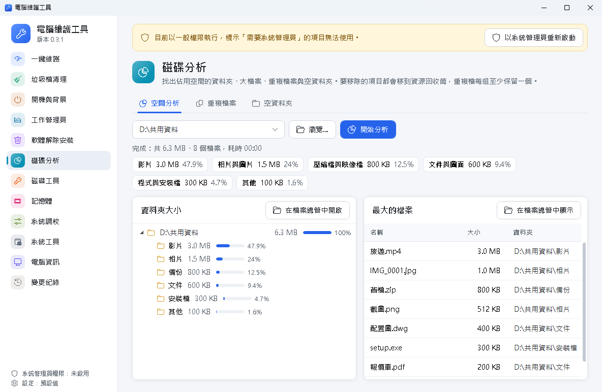
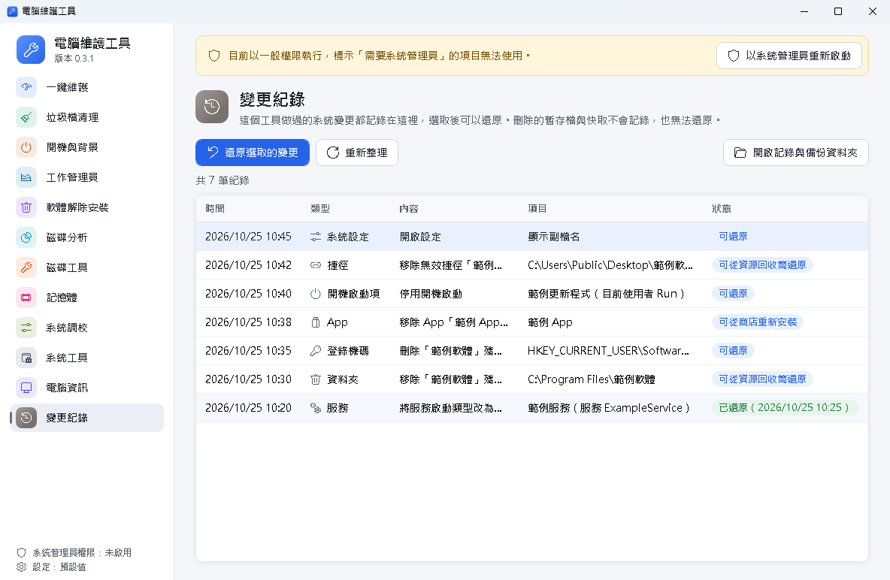

# 電腦維護工具

Windows 10／11 的電腦維護程式，介面為繁體中文：一鍵維護、垃圾檔清理、開機與背景程式、工作管理員、軟體解除安裝、磁碟分析與磁碟工具、記憶體、系統調校與修復工具。做過的系統變更都記在「變更紀錄」，可以還原。不含廣告、不連網、不收集使用資料。

最初是為了在公司多台電腦上取代 Glary Utilities 的常用功能而做，也整合了 Windows 工作管理員，以及 Wintoys 一類工具的系統調校與修復功能。本專案與 Glary Utilities、Wintoys、Microsoft 都沒有關聯。


## 下載

到 [Releases](https://github.com/ernie0/PC-Maintenance-Tool/releases/latest) 下載最新版：

| 檔案 | 大小 | 適用 |
| --- | --- | --- |
| `PcMaintenance-Setup-<版本>.exe`（完整版） | 約 43 MB | 任何 Windows 10／11 64 位元電腦；內含 .NET 執行環境，安裝時不需要網路 |
| `PcMaintenance-Setup-<版本>-lite.exe`（精簡版） | 約 4 MB | 已有 .NET 10 桌面執行環境的電腦；沒有時安裝前會先從 Microsoft 下載安裝（約 58 MB） |
| `電腦維護工具使用說明書-<版本>.pdf` | 約 1.3 MB | 圖文使用說明書；安裝後開始功能表也有 |

安裝檔旁的 `.sha256` 是檢查碼（PowerShell：`Get-FileHash 安裝檔路徑`）。程式與安裝檔沒有數位簽章，第一次執行可能出現「Windows 已保護您的電腦」，確認檢查碼相符後按「其他資訊」→「仍要執行」。

## 功能

| 功能 | 內容 |
| --- | --- |
| 一鍵維護 | 一次檢查暫存檔與快取、無效捷徑、無效的解除安裝項目、使用痕跡、開機程式數量、磁碟空間與健康、防毒保護、重新開機狀態；列出結果後，勾選的項目一鍵處理（可先建立還原點）。執行時跳出進度小視窗，顯示正在做哪一項與實際讀取、處理的數量（不依時間推估）。只處理能還原或會自動重建的項目，其餘只給建議與前往處理的按鈕 |
| 垃圾檔清理 | 使用者／Windows 暫存檔、Edge／Chrome／Firefox 快取、顯示卡著色器快取、縮圖快取、最近使用的項目、程式與系統當機傾印檔、錯誤報告、Windows 更新下載快取、資源回收筒。先掃描、列出大小，勾選後才刪除；也可以設定自動清理 |
| 開機與背景 | 開機啟動項（登錄 Run、啟動資料夾）、排程工作、服務。開機啟動項的停用方式與 Windows 工作管理員相同；排程工作是停用、服務是改啟動類型，都可以還原。服務也可以立即啟動、停止、重新啟動。清單可匯出 CSV |
| 工作管理員 | 處理程序清單（CPU、記憶體、執行緒，每 2 秒更新，可搜尋、排序、結束工作、開啟檔案位置）；效能頁與 Windows 工作管理員相同的版面：CPU（速度、核心、快取、虛擬化）、記憶體（已認可、已快取、分頁集區、插槽）、各磁碟（使用中時間、回應時間、讀寫速度）、網路（傳送接收、IP 位址）、顯示卡（使用率、專用與共用記憶體、驅動程式） |
| 軟體解除安裝 | 列出已安裝軟體並呼叫原廠解除安裝程式；完成後掃描殘留資料夾與登錄機碼，確認後才移除。解除安裝程式已被刪除的項目會標示出來，可直接清掉留下的項目。清單可匯出 CSV。另一分頁列出 Windows 內建與商店 App，可一鍵勾選常見不需要的 App 後為目前使用者移除 |
| 磁碟分析 | 資料夾大小樹狀圖、檔案類型統計（影片、相片、文件等）、最大的檔案、重複檔案（內容完全相同才算）、空資料夾，都可以直接在檔案總管開啟位置 |
| 磁碟工具 | 各磁碟的健康狀態、SSD 或傳統硬碟、剩餘空間；檢查磁碟錯誤、最佳化（SSD 修剪、傳統硬碟重組）、排定開機時修復；系統管理員另可看溫度、使用時數與 SSD 壽命 |
| 記憶體 | 記憶體與虛擬記憶體用量、最占記憶體的程式、已安裝的模組與插槽數；「釋放記憶體」、排定 Windows 記憶體檢測 |
| 系統調校 | 18 個 Windows 設定開關（效能：遊戲模式、GPU 排程、快速啟動、透明效果、儲存空間感知；檔案總管：副檔名、隱藏檔、完整右鍵選單、工作列等；隱私：廣告識別碼、推薦內容、活動記錄、診斷資料等）與電源計畫（可加入終極效能）。每次切換都記在變更紀錄，可還原 |
| 系統工具 | 修復：SFC、DISM RestoreHealth、清理更新元件、重設 Windows 更新、重設 Winsock、備份驅動程式（在系統管理員命令視窗執行）；快速處理：清除 DNS 快取、重建圖示快取、重新啟動檔案總管、重新啟動顯示卡驅動程式、重設 Microsoft Store；還原點；Windows 內建管理工具捷徑（含上帝模式） |
| 電腦資訊 | Windows 版本、功能更新與組建、安裝日期；電腦製造商、型號、序號、主機板、BIOS、安全開機；處理器、記憶體模組、顯示卡、磁碟、網路卡。可複製全部，或匯出 CSV（一台一列，方便彙整多台電腦） |
| 變更紀錄 | 上面做過的系統變更都會記錄，選取後可以還原 |

| 一鍵維護進度 | 系統調校 |
| --- | --- |
|  |  |
| **磁碟分析** | **變更紀錄** |
|  |  |

## 安全設計

- 一律先預覽、再由使用者確認。「一鍵維護」也是先掃描、列出清單、確認後才處理，而且只處理能還原或會自動重建的項目（暫存檔、無效捷徑、只剩清單項目且程式資料夾也不在的軟體、最近開啟紀錄）；開機程式、磁碟、防毒、重新開機只給建議。
- 暫存檔與錯誤報告預設要放超過 24 小時才清理；刪除前會再檢查一次檔案沒有變動、不在排除路徑內，也不會經由連結（junction）刪到別的地方。
- 殘留資料夾、重複檔、空資料夾與無效捷徑是移到資源回收筒；登錄機碼先匯出 .reg 備份再刪除；MSI 安裝的解除安裝資訊一律不動。
- 判斷「檔案不存在」時，沒有權限讀取的路徑一律當成「無法判斷」而不是「不存在」，所以不會把放在受保護資料夾的解除安裝程式或捷徑目標誤判為失效。
- 系統調校只切換 Windows 本身在設定、控制台或群組原則提供的登錄值；切換前的值（含原本不存在的值與機碼）記在變更紀錄，可以原樣還原，寫到一半失敗時會先放回已寫入的值。
- 內建與商店 App 只為目前使用者移除；Microsoft Store、語言套件、開始功能表等 Windows 必要元件不列出。
- 需要系統管理員的修復在 Windows 詢問權限後，於看得到進度的命令視窗執行；重設 Windows 更新是把下載快取改名保留，不刪除。
- 重複檔每組至少保留一份「仍存在且沒變動」的檔案。
- 預設隱藏 Microsoft 的開機項目與服務；Microsoft 的服務一律不允許變更、啟動或停止。
- 結束工作只限目前登入的使用者自己的程式，Windows 必要的處理程序（如 csrss、winlogon、檔案總管）與系統服務不提供結束；結束前會確認，並核對沒有誤殺剛好重複使用同一編號的其他程式。
- 磁碟工具只呼叫 Windows 內建的 chkdsk、defrag、fsutil；「檢查錯誤」只檢查不修改，需要修復時改為排定在下次開機、檔案都還沒開啟時由 Windows 處理。
- 「釋放記憶體」只請程式交還暫時用不到的記憶體，不會關閉程式，也不碰系統服務。
- 平常以一般權限執行；需要系統管理員權限的項目會標示，按上方按鈕才重新以系統管理員啟動。

## 系統需求

Windows 10／11 64 位元。完整版安裝檔已內含 .NET 執行環境，不需另外安裝；精簡版使用電腦上的 .NET 10 桌面執行環境，電腦沒有時安裝檔會先從 Microsoft 下載安裝（見下方「安裝與部署」）。

## 介面與動畫

每項功能有自己的顏色與圖示；滑鼠移到功能或按鈕上時圖示會動，切換頁面時淡入，執行中的按鈕顯示轉動的圓圈，完成的項目出現勾號。動畫只在狀態改變時播放一次，轉動的圓圈只在畫面上看得到時才轉，程式閒置時不會因為動畫占用處理器。Windows 關閉「動畫效果」（Windows 10 為「在 Windows 中顯示動畫」）或以遠端桌面連線時不播放動畫。

開發時新增的圖示動畫寫在 `src/PcMaintenance.App/Behaviors.cs`（`Motion.Kind`、`Glyph.Text` 等附加屬性），各頁顏色與圖示在 `MainViewModel` 的頁面清單。

## 安裝與部署

兩種安裝檔（見上方「下載」；自行打包時在 `dist\`）都安裝到 `C:\Program Files\PcMaintenance`，需要系統管理員權限。兩種的程式相同，功能一樣，啟動時間與記憶體用量實測相當，可以互相升級取代，設定與使用者資料都保留。

精簡版下載的是 Microsoft 官方的 .NET 10.0.14 桌面執行環境，需要能連上 `builds.dotnet.microsoft.com`；下載後核對 SHA-256，不符就不執行，「準備安裝」頁也會先註明要下載。解除安裝電腦維護工具時不會移除這個執行環境（其他程式也可能用到），之後的安全性更新由 Microsoft Update（Windows Update 的「接收其他 Microsoft 產品的更新」）或公司的派送工具提供。

圖文使用說明書 `電腦維護工具使用說明書-<版本>.pdf` 在 Releases 與自行打包的 `dist\`（可編輯版為同名 .docx），安裝後開始功能表也有「電腦維護工具使用說明書」。

靜默安裝（例如用派送工具或登入指令碼）：

```bat
PcMaintenance-Setup-0.3.1.exe /VERYSILENT /SUPPRESSMSGBOXES /NORESTART /SETTINGS="\\伺服器\共用\settings.json" /TASKS="autoclean"
```

| 參數 | 用途 |
| --- | --- |
| `/SETTINGS="路徑"` | 把公司設定檔複製到 `C:\ProgramData\PcMaintenance\settings.json`。相對路徑以安裝檔所在資料夾為準；找不到檔案時安裝會中止（結束代碼 7） |
| `/TASKS="autoclean"` | 開啟自動清理（預設不開，見下方說明）；要同時建立桌面捷徑寫成 `/TASKS="autoclean,desktopicon"` |
| `/TASKS="desktopicon"` | 建立桌面捷徑（預設不建立） |
| `/LOG="C:\Windows\Temp\PcMaintenance-安裝.log"` | 留下安裝記錄 |

精簡版用同樣的參數；沒有執行環境的電腦在靜默安裝時也會自動下載安裝。安裝檔的結束代碼：0 完成；7 安裝前停止（找不到 `/SETTINGS` 的檔案，或精簡版無法下載或安裝執行環境，原因寫在 `/LOG` 的記錄檔）；其他非 0 值表示沒有完成。不能連外的電腦請用完整版，或先派送 Microsoft 的 .NET 10 桌面執行環境安裝檔（`windowsdesktop-runtime-10.0.<n>-win-x64.exe /install /quiet /norestart`）。

靜默解除安裝：

```bat
"C:\Program Files\PcMaintenance\unins000.exe" /VERYSILENT /SUPPRESSMSGBOXES /NORESTART
```

升級時直接執行新版安裝檔即可，設定檔不會被覆蓋（除非再次指定 `/SETTINGS`）。

## 自動清理

安裝時勾選「自動清理」（或 `/TASKS="autoclean"`），每位使用者登入時程式會在背景以低優先權執行一次 `--auto-clean`：

- 距離這位使用者上次自動清理未滿設定天數（`autoCleanIntervalDays`，預設 7 天）就直接結束。
- 只清理畫面上預設勾選的項目，不清空資源回收筒，也不處理需要系統管理員權限的項目。
- 瀏覽器正在執行時略過它的快取，不會關閉任何程式。
- 結果寫在每日記錄檔，「垃圾檔清理」頁下方也會顯示上次自動清理的時間與釋放空間。

要關閉：重新安裝時不勾選，或在「開機與背景」停用名為 `PcMaintenanceAutoClean` 的開機啟動項。

## 命令列

不開視窗、只寫記錄檔（`%LOCALAPPDATA%\PcMaintenance\logs`），適合派送工具或排程使用。

| 參數 | 用途 |
| --- | --- |
| `--clean` | 立即清理預設勾選的項目 |
| `--clean --dry-run` | 只列出會清理的內容，不刪除任何檔案 |
| `--auto-clean` | 距離上次自動清理超過設定天數才清理 |
| `--export-software <檔案或資料夾>` | 匯出軟體清單 CSV；給資料夾時檔名自動帶電腦名稱與日期，方便收集各台電腦的清單 |
| `--export-startup <檔案或資料夾>` | 匯出開機與背景項目 CSV |
| `--export-system <檔案或資料夾>` | 匯出電腦配備與系統版本 CSV（一台一列） |
| `--restore-point` | 建立系統還原點（需要以系統管理員執行；畫面上的「建立還原點」在一般權限時也是透過它請 Windows 詢問權限） |

結束代碼：0 成功（含未到時間而略過）、1 執行失敗、2 參數錯誤；`--restore-point` 另有 3（24 小時內已有還原點，Windows 略過）、4（系統保護未開啟）。例：

```bat
"C:\Program Files\PcMaintenance\PcMaintenance.exe" --export-software "\\伺服器\共用\軟體盤點\"
```

## 公司設定檔

程式依序讀取第一個存在的設定檔：

1. `C:\ProgramData\PcMaintenance\settings.json`（建議，全公司共用）
2. 程式資料夾內的 `settings.json`

都沒有時使用預設值。範例與每個欄位的說明在 `C:\ProgramData\PcMaintenance\settings.example.json`（原始檔在 [installer/settings.example.json](installer/settings.example.json)），內容與預設值相同，可以複製成 `settings.json` 再改。格式錯誤時程式會改用預設值，並在畫面上方顯示提醒。程式左下角會顯示「設定：預設值」或「設定：公司設定檔」，實際讀取的路徑記在每日記錄檔。

## 使用者資料

每位使用者各自一份，位於 `%LOCALAPPDATA%\PcMaintenance`：

- `journal.json`：變更紀錄（還原用）
- `backups\`：刪除登錄機碼前的 .reg 備份
- `logs\`：每日操作記錄
- `auto-clean.json`：上次自動清理的時間與結果
- `maintenance.json`：上次一鍵維護的時間、處理項數與釋放空間

解除安裝不會刪除這些資料，避免之後無法還原。

## 開發與打包

- 需要 .NET 10 SDK；打包另需 Inno Setup 6 或 7。
- 結構：`src/PcMaintenance.Core`（功能邏輯）、`src/PcMaintenance.App`（WPF 介面）、`tests/PcMaintenance.Core.Tests`（xUnit）。
- 建置、測試與直接執行：`dotnet build PcMaintenance.slnx`、`dotnet test tests\PcMaintenance.Core.Tests`、`dotnet run --project src\PcMaintenance.App`。
- 打包：`pwsh -File installer\build-installer.ps1`，會依序跑測試、發佈 win-x64 單一 exe 兩種（完整版自帶執行環境、精簡版使用電腦上的執行環境）、編譯兩個安裝檔並各產生 SHA-256。版本號在 `Directory.Build.props`；精簡版要下載的執行環境版本與 SHA-256 在 `installer\PcMaintenance.iss` 開頭（`RuntimeVersion`、`RuntimeSha256`），換版本的方法寫在旁邊的註解。
- 使用說明書：先更新 `docs\manual\images` 的截圖，再執行 `pwsh -File docs\manual\build-manual.ps1 -Python <裝有 python-docx 的 python.exe>`（需要 Word，用來更新目錄並另存 PDF）。要讓安裝檔帶說明書，先產說明書再打包。

## 已知限制

- 程式與安裝檔沒有數位簽章：從網路下載的副本會出現 SmartScreen 警告，部分防毒軟體可能需要加入例外。
- 精簡版在沒有 .NET 10 的電腦上第一次安裝需要網路（使用系統的 Proxy 設定）；公司網路擋 Microsoft 下載站時請改用完整版。程式本身仍不連網。
- 殘留檔是依軟體名稱比對找出，可能有誤判，所以使用者資料夾與 `Software\廠商\軟體` 類的項目預設不勾選，請確認後再移除。
- 清空資源回收筒、刪除暫存檔與快取無法從變更紀錄還原；服務的啟動與停止只持續到下次重新開機，所以只寫入記錄檔，不列入變更紀錄。
- 還原排程工作、服務與 HKLM 項目，以及磁碟的檢查、最佳化、排定修復，都需要系統管理員權限。
- 磁碟溫度、使用時數與壽命要看磁碟本身是否提供；部分 USB 隨身碟與舊硬碟不提供。
- 「釋放記憶體」的效果是暫時的；Windows 本身就會管理記憶體，平常不需要經常使用。
- 系統調校中寫入 HKLM 或原則（Policies）的開關需要系統管理員權限；只有特定 Windows 版本才有的設定（例如 Windows 11 的完整右鍵選單）在其他版本會標示為無法使用。
- 移除內建 App 只影響目前使用者，新建立的帳號仍會有這些 App。
- 較新的 Windows（本機測試的組建 26300）一般權限無法清除 DNS 快取，按下後 Windows 會詢問系統管理員權限。
- 不提供登錄檔清理、檔案粉碎、救回已刪除檔案等功能。

## 授權

以 [MIT 授權](LICENSE)釋出。安裝檔內含的第三方元件（完整版內含 .NET 執行環境，以及 CommunityToolkit.Mvvm 等套件）的授權聲明見 [THIRD-PARTY-NOTICES.txt](THIRD-PARTY-NOTICES.txt)，安裝後也放在程式資料夾。

## 回報問題

使用上的問題或建議請到 [Issues](https://github.com/ernie0/PC-Maintenance-Tool/issues)，附上 Windows 版本、操作步驟，以及 `%LOCALAPPDATA%\PcMaintenance\logs` 當天的記錄檔（請先確認裡面沒有不想公開的路徑或名稱）。
